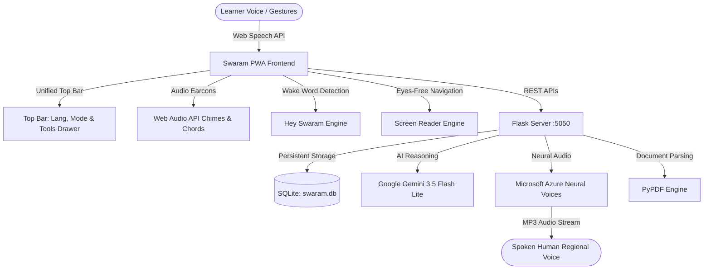

# Swaram - Voice-First AI Skill Coach & Accessibility Assistant

An intelligent, accessible, zero-screen voice tutor designed for visually impaired and hands-free learners in India. 
Speak in **Telugu**, **Hindi**, **English** (and 8 more Indian languages) to learn practical skills, ask any question, practice job interviews, study uploaded PDF notes, and detect cyber/UPI scams.

---

## 🌟 Key Features

1. **🎙️ "Hey Swaram" Background Wake-Word (Like Apple Siri / Google Assistant)**
   - Operates in the background even when Chrome is minimized or another app is open.
   - Dual-tone chime on wake up.
   - Inaudible audio keep-alive and WakeLock prevent browser throttling.

2. **🗣️ Real Human Neural Voice (Microsoft Azure Neural Voices)**
   - Native regional voices with natural breathing and intonation:
     - 🇮🇳 **Telugu**: `te-IN-ShrutiNeural`
     - 🇮🇳 **Hindi**: `hi-IN-SwaraNeural`
     - 🌐 **English**: `en-IN-NeerjaNeural`
     - *+ Tamil, Kannada, Malayalam, Marathi, Bengali, Gujarati, Punjabi, Urdu*
   - Automatic fallback to Google TTS and local speech synthesis.

3. **📱 Unified Sleek Top Bar & Collapsible Tools Drawer**
   - **Language Dropdown (`#langSelect`)**: Instant switching across 11 Indian languages.
   - **Mode Dropdown (`#modeSelect`)**: Seamless switching between Voice Chat, Voice Quiz, Tech Lesson, Audio Story, Pronounce, Riddle Game, and Voice Form.
   - **Collapsible Drawer (`#toolsDrawer`)**: One-tap toggle for utility chips (Wake Word, Upload Notes, Progress Stats, Read Screen, Voice Lock, Add Contact, Policy).

4. **💾 Persistent SQLite Database Layer (`swaram.db`)**
   - User authentication (`/api/auth/register`, `/api/auth/login`).
   - Persistent progress (completed questions, modules, quiz scores, learning streaks).
   - Saved study documents and PDF notes.
   - Multilingual voice form responses.

5. **🎯 Interactive Voice Quiz & Real-time Scoring**
   - Say *"Hey Swaram, start quiz"* or *"Quiz me on my notes"*.
   - Generates 3 voice-tailored questions with encouraging instant feedback and score tracking.
   - Web Audio earcons play celebratory chords on correct answers and gentle cues on incorrect answers.

6. **💡 Structured Tech Curriculum (DSA & Python Basics)**
   - Say *"Hey Swaram, teach me Python"* or *"Teach me Data Structures"*.
   - Explains complex programming concepts using simple, everyday spoken analogies without code blocks.

7. **📖 Interactive Branching Storytelling & PDF Page Reader**
   - Say *"Hey Swaram, tell me a story"*. Swaram narrates and asks your choices to determine the plot!
   - Say *"Hey Swaram, read page 1"* to read your uploaded study notes page-by-page.

8. **👂 Accessibility Audio Cues (Earcons)**
   - Rising chime when listening starts (`440Hz → 880Hz`).
   - Soft descending tone when listening stops (`660Hz → 330Hz`).
   - Triumphant chord on correct quiz answer (`C5 → E5 → G5`).

9. **⚡ Voice-Driven TTS Speed Control**
   - Say *"Speak slower"* / *"నెమ్మదిగా మాట్లాడు"* / *"धीरे बोलो"* (`0.8x`).
   - Say *"Speak faster"* / *"వేగంగా మాట్లాడు"* / *"तेज़ बोलो"* (`1.25x`).
   - Say *"Normal speed"* (`1.0x`).

10. **👆 Screen-Free Gestures (Double-Tap & Swipe Left)**
    - **Double-Tap:** Toggles listening hands-free.
    - **Swipe Left:** Repeats the last spoken answer.

11. **👁️ Voice Screen Reader ("Read Screen")**
    - Say *"Read screen"* or *"స్క్రీన్ చదువు"*.
    - Reads aloud whatever is active on screen: quiz questions, lesson concepts, stories, or form prompts.

12. **📶 Offline Resilience & PWA Installability**
    - Service Worker (`swaram-v13`) caches shell assets and PWA icons.
    - Works offline with local voice fallback and emergency safety commands.

---

## 🚀 Quick Start Guide

### 1. Install Dependencies
```bash
python -m pip install -r requirements.txt
```
*(Packages: Flask, requests, edge-tts, pypdf)*

### 2. Set Your Gemini API Key
```powershell
$env:GEMINI_API_KEY="your_gemini_api_key_here"
```
*(Get a free key at https://aistudio.google.com/apikey)*

### 3. Start the Server
```bash
python app.py
```

### 4. Open in Google Chrome
Go to **http://localhost:5050** in Google Chrome and allow microphone access.

---

## 🎯 Voice Commands Quick Reference

- **Wake word**: *"Hey Swaram"* / *"హే స్వరం"* / *"हे स्वरम"*
- **Read screen**: *"Read screen"* / *"What is displaying on screen?"* / *"స్క్రీన్ చదువు"* / *"स्क्रीन पढ़ो"*
- **Voice Quiz**: *"Start quiz"* / *"Quiz on solar system"* / *"క్విజ్ ప్రారంభించు"* / *"क्विज़ शुरू करो"*
- **Tech Lesson**: *"Teach me Python"* / *"Teach me DSA"* / *"పాఠం చెప్పు"* / *"पाठ सिखाओ"*
- **Storytelling**: *"Tell me a story"* / *"Story about courage"* / *"కథ చెప్పు"* / *"कहानी सुनाओ"*
- **Pronunciation**: *"Pronounce algorithm"* / *"How to pronounce entrepreneur"* / *"ఉచ్చారణ"*
- **Voice Game**: *"Play a game"* / *"Ask me a riddle"* / *"ఆట ఆడుదాం"* / *"पहेली पूछो"*
- **Voice Form**: *"Fill form"* / *"Voice form"* / *"ఫారమ్ నింపు"* / *"फॉर्म भरो"*
- **Read PDF Page**: *"Read page 1"* / *"పేజీ 1 చదువు"* / *"पेज 1 पढ़ो"*
- **Speed Control**: *"Speak slower"* / *"Speak faster"* / *"Normal speed"*
- **Repeat Response**: *"Repeat"* / *"Say that again"* / *"మళ్ళీ చెప్పు"* / *"दोहराओ"*
- **Study notes**: *"Upload notes"*, *"Summarize my notes"*, *"Quiz me on this PDF"*
- **Progress**: *"What is my progress?"* / *"నా ప్రోగ్రెస్ ఎంత?"* / *"मेरी प्रगति"*
- **Calling**: *"Call Amma"*, *"Add contact Suresh 9876543210"*, *"Call 112"*
- **Language**: Say *"Telugu"*, *"Hindi"*, or *"English"* anytime to switch languages.

---

## 🏗️ Architecture


