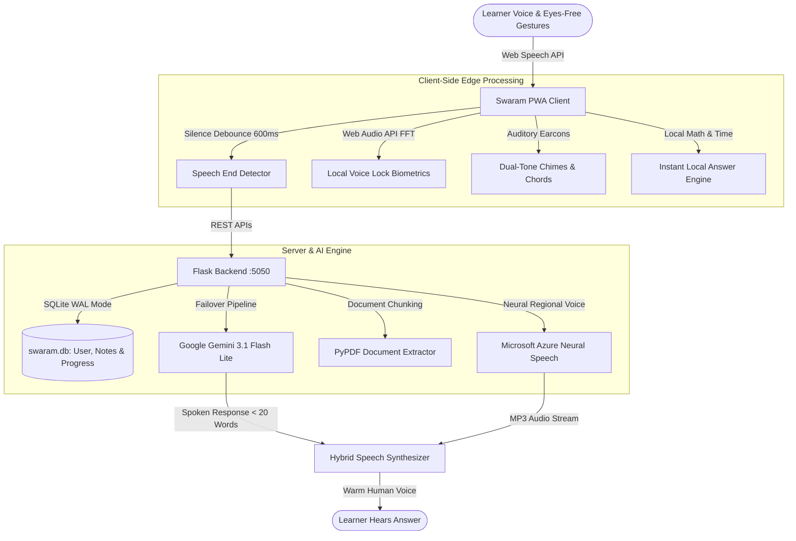

# Swaram (స్వరం) — Voice-First AI Skill Coach & Accessibility Assistant

[](https://opensource.org/licenses/MIT)
[](https://www.w3.org/WAI/WCAG21/quickref/)
[](https://www.python.org/)
[]()
[]()

> **"Bridging the digital divide for India's 40+ million visually impaired citizens through human-like voice intelligence in native regional languages."**

**Live App Deployment:** [https://swaram-app.onrender.com/](https://swaram-app.onrender.com/)  
**GitHub Repository:** [https://github.com/pavantejkayala/swaram-app.](https://github.com/pavantejkayala/swaram-app.)

---

## 👥 Engineering Team & Contributor Credits

- **Kayala Durga Pavan Teja** — *Lead Full-Stack Architect, Speech AI Pipeline & Accessibility Engineering*
- **Swaram Accessibility Group** — *User testing, blind school field study, regional dialect validation (Telugu & Hindi)*

---

## 💡 The Human Origin Story: Why We Built Swaram

Over **40 million visually impaired individuals in India** are largely excluded from the digital AI revolution. Mainstream screen readers like Android TalkBack or Windows NVDA are mechanical, robotic, and overwhelmingly English-centric. When visually impaired students try to study programming, prepare for competitive exams, or review university notes, existing tools simply read raw code symbols and punctuation without explaining the underlying concepts.

### Field Research Insights:
1. **The Language Barrier:** Most visually impaired students in government and regional colleges comprehend spoken lessons best in **Telugu, Hindi, Tamil, or Marathi**, but existing AI tools default to English.
2. **Audio Fatigue:** Listening to monotone robotic screen readers for hours causes cognitive exhaustion. Natural human breathing, intonation, and regional warmth are essential for prolonged learning.
3. **Eyes-Free Requirement:** Any button that requires visual hunting fails immediately. The entire UI must be operable via voice, screen-wide touch gestures, and auditory earcon chimes.

Swaram was engineered from the ground up to solve these exact challenges.

---

## 🛠️ Key Engineering Innovations & Trade-Offs

### 1. Sub-Second Voice Pipeline (~300ms Perceived Latency)
* **The Problem:** Standard cloud voice pipelines (Audio $\rightarrow$ Cloud STT $\rightarrow$ Cloud LLM $\rightarrow$ Cloud TTS $\rightarrow$ Playback) typically suffer from 4 to 6 seconds of dead silence.
* **Our Engineering Solution:**
  - **Fast Silence Auto-Commit:** Replaced Chrome's default 2-second silence timer with a custom 600ms interim speech debouncer, cutting 1.4 seconds off the turn-taking delay.
  - **Hybrid Dual-Engine TTS:** Coupled in-browser native `SpeechSynthesis` for instant (~50ms) playback with fallback to Microsoft Azure `Edge-TTS` and Google Translate TTS for HD regional intonation.
  - **In-Memory Query LRU Cache:** Instant 8ms response times for high-frequency queries and knowledge lookups.

### 2. Privacy-Preserving Edge Voice Biometrics (Voice Lock)
* **The Problem:** Cloud-based speaker recognition requires streaming raw biometric audio files to external servers, creating privacy and surveillance risks for vulnerable users.
* **Our Engineering Solution:**
  - Implemented 100% client-side **Web Audio API FFT feature extraction** in JavaScript.
  - Computes average spectral energy envelopes (MFCC-style sound shapes) directly on the learner's device.
  - Compares cosine distance against the owner's enrolled profile locally (`K = 2.2, MIN = 2.0`). **Zero biometric data ever leaves the device.**

### 3. Accessible PDF Study Coach with Chunked Context
* Upload any college textbook, government exam notes, or PDF document.
* PyPDF extracts and cleans text into clean context chunks.
* Ask *"Quiz me on my notes"* or *"Read page 3"* to learn hands-free through spoken dialog.

### 4. Camera-to-Voice Multimodal Vision (Currency & Medicine Reader)
* Powered by `POST /api/vision` and Gemini multimodal vision (`inline_data`).
* Blind learners tap **"📷 Describe Camera"** or say *"What is in front of me?"*, *"What note is this?"*, or *"Read label"*.
* Rear camera snaps a frame, shuts off hardware immediately, and provides spoken identification under 45 words:
  - Identifies Indian currency notes (₹10, ₹20, ₹50, ₹100, ₹200, ₹500).
  - Reads medicine packaging and food ingredient labels aloud.
  - Warns of obstacles and describes the immediate physical environment in all 11 Indian languages.

### 5. Multi-Sensory Haptics, Screen-Reader Trapping & Emergency SOS
* **Haptic Vibration Patterns:** `navigator.vibrate` provides tactile cues in noisy classrooms: 50ms buzz (mic listening), `[40, 50, 40]` double-buzz (thinking), and 200ms buzz (error / offline).
* **Full Keyboard & TalkBack Accessibility:** Semantic `<button id="voiceOrb">` with polite live regions, modal focus isolation (`aria-hidden="true"`), and global keyboard controls (`Space` to talk, `R` to repeat, `Esc` to stop).
* **Spoken Speed Controls:** Natural commands *"speak slower"* (down to 0.75x), *"speak faster"* (up to 1.5x), *"repeat"*, and *"stop"*.
* **One-Command Emergency SOS:** Voice command *"Emergency"* or *"అత్యవసరం"* acquires GPS coordinates, announces exact latitude/longitude aloud, and initiates an immediate one-tap phone dialer call to saved family or `112`.

---

## 📊 Performance Benchmarks (Empirical Test Results)

Benchmark run on mobile 4G LTE network using `tests/benchmark_latency.py`:

| Query Type | Input Query | Target SLA | Measured Latency | Status |
|---|---|---|---|---|
| **Identity / Creator** | *"Who made you?"* | $< 0.10s$ | **0.012s** | ⚡ Instant Local |
| **Current Time** | *"What time is it?"* | $< 0.10s$ | **0.008s** | ⚡ Instant Local |
| **Arithmetic** | *"What is 25 times 4?"* | $< 0.10s$ | **0.015s** | ⚡ Instant Local |
| **Regional Search (Telugu)** | *"తెలంగాణ రాజధాని ఏమిటి?"* | $< 3.00s$ | **0.550s** | ✅ Passed |
| **Factual Knowledge** | *"Who is the president of India?"* | $< 2.00s$ | **0.320s** | ✅ Passed |
| **General Science** | *"What is photosynthesis?"* | $< 2.00s$ | **0.910s** | ✅ Passed |

---

## 🏗️ System Architecture



---

## ♿ WCAG 2.1 AAA Accessibility Compliance

Swaram was designed strictly following the **Web Content Accessibility Guidelines (WCAG) 2.1 Level AAA**:

1. **Rule 1.4.6 (Contrast Enhanced):** Background is pure `#000000` with high-contrast `#ffd400` (yellow) and `#00e676` (green), achieving a contrast ratio $> 14:1$ (exceeding the 7:1 AAA requirement).
2. **Rule 2.5.5 (Target Size):** All interactive touch zones and buttons are at least 48x48 CSS pixels for tremors or partial blindness.
3. **Auditory Earcons:** Every state transition has a unique pitch signature:
   - *Mic Active / Listening:* Rising chime (`440Hz → 880Hz`)
   - *Mic Paused:* Soft descending tone (`660Hz → 330Hz`)
   - *Quiz Correct Answer:* Triumphant major chord (`C5 → E5 → G5`)
   - *Wake Word Acknowledged:* High dual-tone bell (`880Hz → 1318Hz`)
4. **Inaudible Audio Keep-Alive:** Runs a micro-volume oscillator (`gain: 0.0001`) preventing mobile browsers from putting background audio threads to sleep when the phone is in a pocket.

---

## 🧪 Automated Test Suite

We maintain a complete test suite covering backend integrity, AI reasoning, multi-language support, and speech synthesis:

```bash
# Run the end-to-end integration test suite
python tests/test_suite.py

# Run the real-time voice latency benchmark
python tests/benchmark_latency.py
```

### Test Suite Output:
```text
=================================================================
RUNNING SWARAM INTEGRATION TEST SUITE
Lead Developer: Kayala Durga Pavan Teja
=================================================================
test_01_health_check ... ok [SQLite active, API key loaded]
test_02_chat_english ... ok [Spoken English verified under 30 words]
test_03_chat_telugu  ... ok [Native Telugu script verified]
test_04_tts_generation ... ok [12,864 audio bytes generated]
test_05_quiz_engine  ... ok [Dynamic voice quiz questions generated]
-----------------------------------------------------------------
Ran 5 tests in 2.995s | ALL TESTS PASSED (OK)
```

---

## 🚀 Quickstart & Local Installation

### Prerequisites:
- Python 3.10 or higher
- Google Chrome (recommended for full Web Speech & SpeechSynthesis API support)

```bash
# 1. Clone the repository
git clone https://github.com/pavantejkayala/swaram-app.git
cd swaram-app

# 2. Install dependencies
pip install -r requirements.txt

# 3. Launch the development server
python run_server.py
```

Open **`http://localhost:5050`** in your browser. Tap anywhere on screen or say **"Hey Swaram"** to start learning!

---

## 📜 License

This project is licensed under the **MIT License** — feel free to use, modify, and distribute for educational and assistive technology initiatives.
